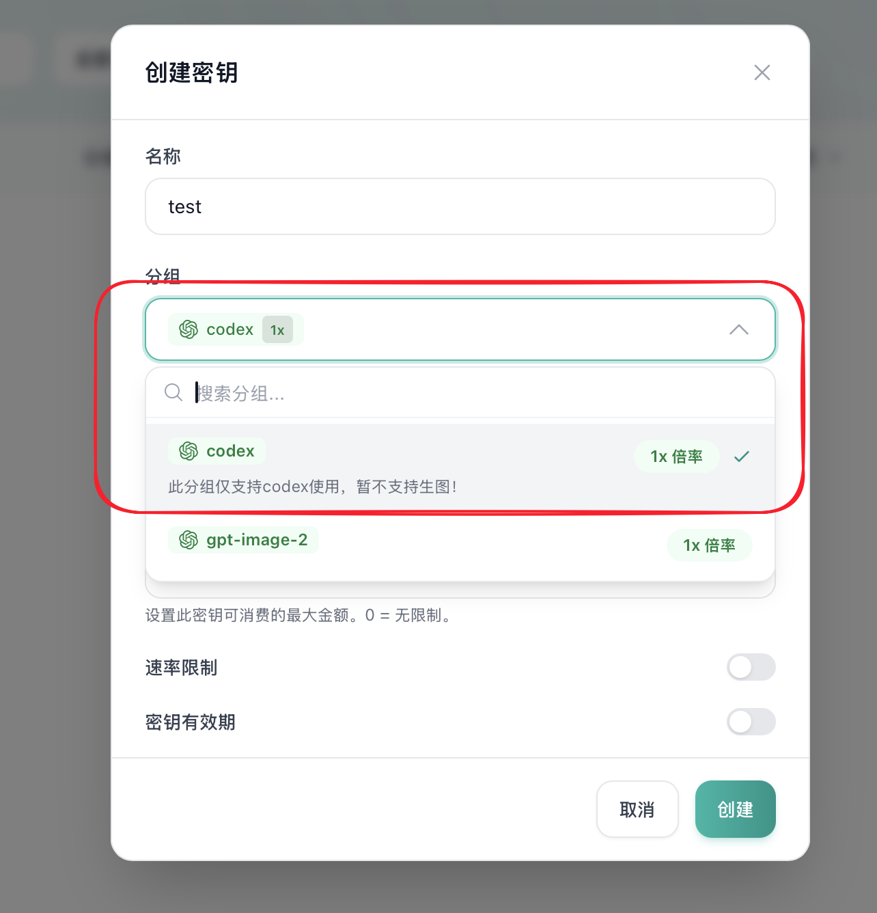
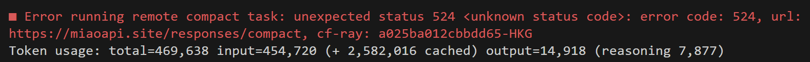
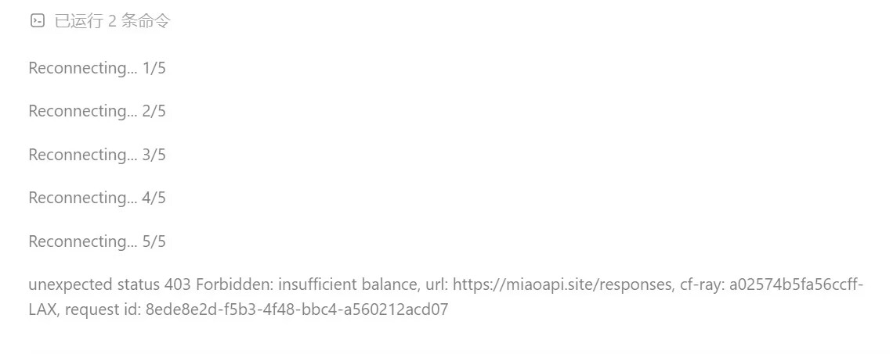

# API中转使用教程

[https://api.miantuan.ltd/]()

API中转站提供的API可用于国内网络环境不翻墙使用Codex Cli、Codex App及Opencode、OpenClaw等，当然也可用于在Python代码中调用API。

## 如何安装codex cli/app？

如果您有翻墙/梯子，强烈建议上官网直接安装codex app，根据您的系统下载即可。

[https://openai.com/zh-Hans-CN/codex/]()

对于codex cli，您需要先安装Node\.js

[http://nodejs.org/zh-cn?utm_source=chatgpt.com]()

安装完成Node\.js后，打开终端，输入

```Bash
node -v
npm -v
```

查看是否正确安装。

接着输入以下命令，并等待安装（这一步最好挂梯子）

```Bash
npm install -g @openai/codex
```

安装完成后，输入

```Bash
codex
```

即可打开codex cli，此时您尚未配置API，打开后可按ctrl\+c先退出，按照下面操作进行配置。

如果您在输入安装命令时卡住，建议使用阿里云镜像，也即下面这个命令

```Bash
npm install -g @openai/codex --registry=https://registry.npmmirror.com
```

## 如何在Codex Cli和Codex App中使用面团API？

### 使用开源软件CC switch帮助管理（方法一，推荐）

非常推荐使用CC swtich，您可以随意地切换不同中转站/官方的订阅，保持本地长久会话不被破坏。

首先安装CC switch
https://ccswitch\.io/zh/


下面讲一下如何导入我们的某个密钥配置

首先进入你的账号，然后创建API key。

这里点击“创建密钥”


这里选择codex分组即可（如您之后订阅了套餐，请新建密钥选择套餐的专属分组）




接着点击“导入到CCS”这个按钮。


允许即可！

这里点“导入”确定。

OK，我们现在有两个配置了。

可以改一下名，比如我把刚导入的改为test，然后点击启动，就可以自动切换密钥啦！（这里的查询失败是bug，不影响）

如果您还有官方订阅（或其他中转站），可以点击右上角的➕号

选择Openai Official


点击添加


再点击启用官方订阅。

随后打开中转，随便找个文件夹，输入codex logout。


出现successfully logged out之后，再输入codex，利用网页认证登录您的gpt账号即可，会话将不会消失。


如您需要切换回中转站，可以点击中转站的启用即可。

## 部分报错及解决方法

1\.



出现这个情况大概率是你config\.toml中自动压缩的窗口大小设置的不合理

建议改成这样，就不会出现这种问题了


2\.



这说明您现在的密钥所在分组下额度不足，如果您刚开通了订阅套餐，请新建一个该订阅分组下的密钥，然后用CC switch切换即可。


